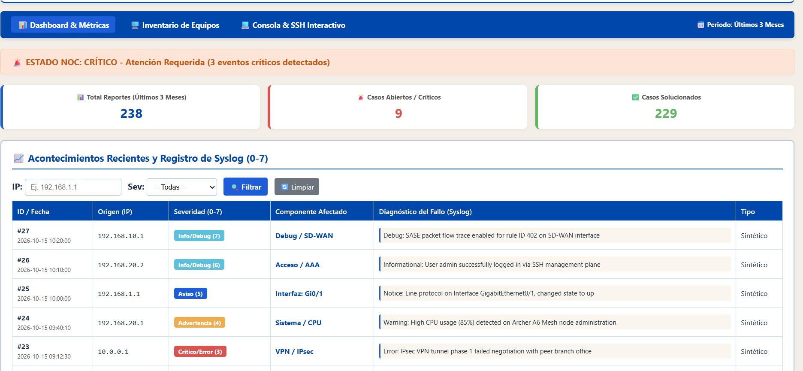
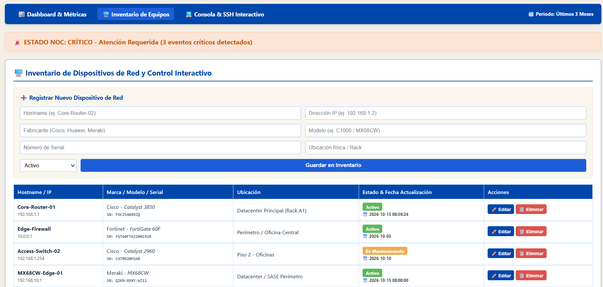
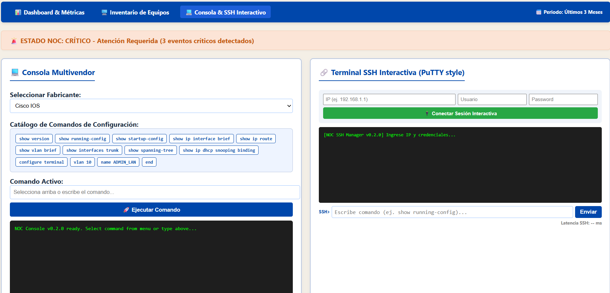

# 🛡️ NOC Syslog Inteligente (Enterprise Light Edition)

Sistema avanzado de monitoreo, ingesta y análisis de eventos Syslog multivendor en tiempo real con consola interactiva SSH, desarrollado como proyecto para el curso de **Administración y Gestión de Redes**.

* **Estudiante:** Faryd Albenis Garcia Moreno[cite: 1]
* **Institución:** Fundación Universitaria Compensar[cite: 1]
* **Periodo:** 2026-2
* **Versión:** 0.2.0 Alfa

---

## 📸 Vista Previa del Dashboard

### 1. 📊 Dashboard & Métricas


### 2. 🖥️ Inventario de Equipos


### 3. 💻 Consola & SSH Interactivo


> *Plataforma interactiva con navegación modular por pestañas, métricas de incidentes de los últimos 3 meses, gestión de inventario y terminal SSH en tiempo real.*

---

## 🏗️ Arquitectura de Referencia

El proyecto implementa una arquitectura de monitoreo desacoplada y escalable:

```text
[ Equipos ]          [ Colector ]         [ Aplicación ]       [ Datos ]            [ Interfaz ]
Cisco · Fortinet  -> UDP/TCP/TLS Syslog -> Python / Flask   -> SQLite Database -> Dashboard + Alertas
· Huawei · Meraki                                                                   + SSH Interactivo